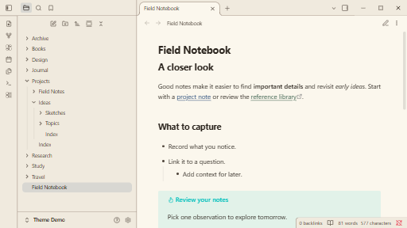

# Readable Typography

A typography-focused Obsidian theme for comfortable reading and writing.

Source version 1.0.1. Modes supported: Dark and light. Tested in Obsidian 1.15.1 on Windows.

Adjust the text font and size in Obsidian Appearance. Lexend and Atkinson Hyperlegible are optional local fonts.

## Preview

## Install manually

1. Download `manifest.json` and `theme.css` from [release 1.0.0](https://github.com/tutivsoft-com/obsidian-theme-readable-typography/releases/tag/1.0.0).
2. Put both files in `.obsidian/themes/Readable Typography/` in your vault.
3. Open **Settings > Appearance** and select **Readable Typography**. Choose a supported base colour scheme.

See the [original design plan](PLAN.md). [MIT license](LICENSE).
