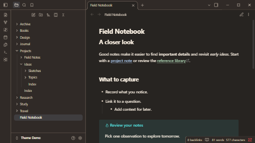

# Readable Typography

A typography-focused Obsidian theme for comfortable reading and writing.

Source version 3.6.1. Supports light and dark modes. Requires Obsidian 1.15.1 or later.

Adjust the text font and size in Obsidian Appearance. Lexend and Atkinson Hyperlegible are optional local fonts.

## Preview

## Install manually

1. Download `manifest.json` and `theme.css` from the [latest published release](https://github.com/tutivsoft-com/obsidian-theme-readable-typography/releases/latest). To install the source version, take both files from the same checkout.
2. Put both files in `.obsidian/themes/Readable Typography/` in your vault.
3. Open **Settings > Appearance** and select **Readable Typography**. Choose a supported base colour scheme.

## Check the source

With Python 3 and `tinycss2` installed, run `python -B -m unittest discover -s tests -v` from the repository root. The tests check stylesheet declarations, note text and list marker contrast in both modes, and source version consistency.

See the [November 2026 design plan](PLAN.md). [MIT license](LICENSE).
